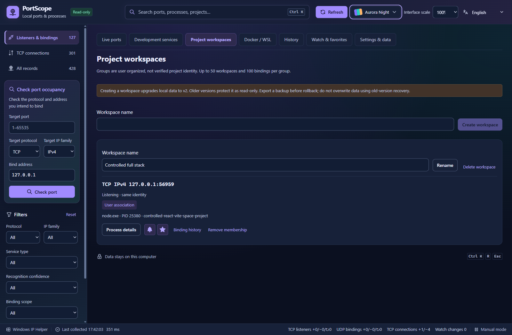
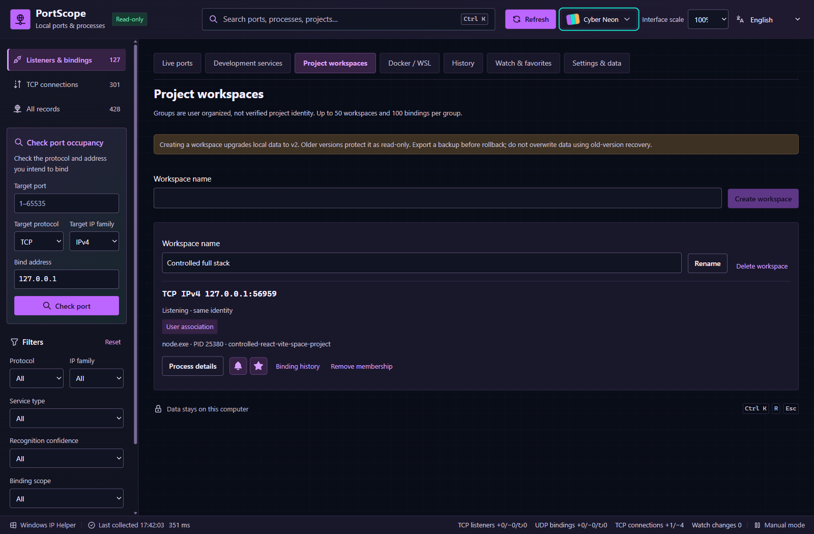
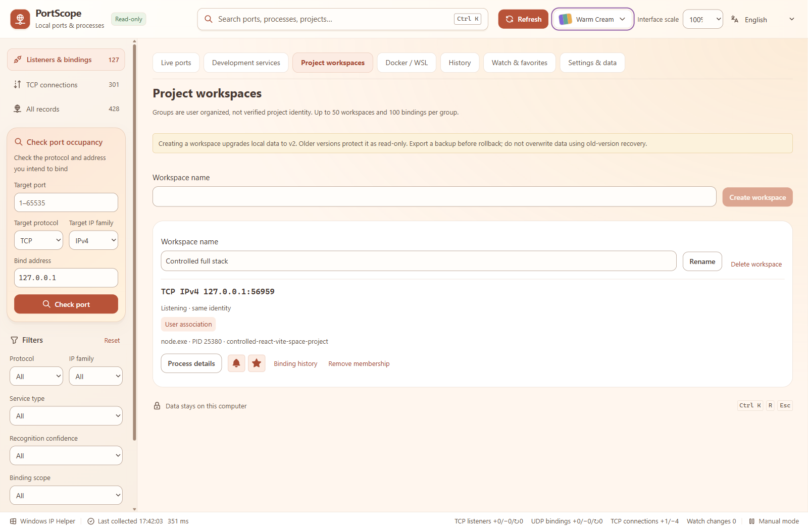
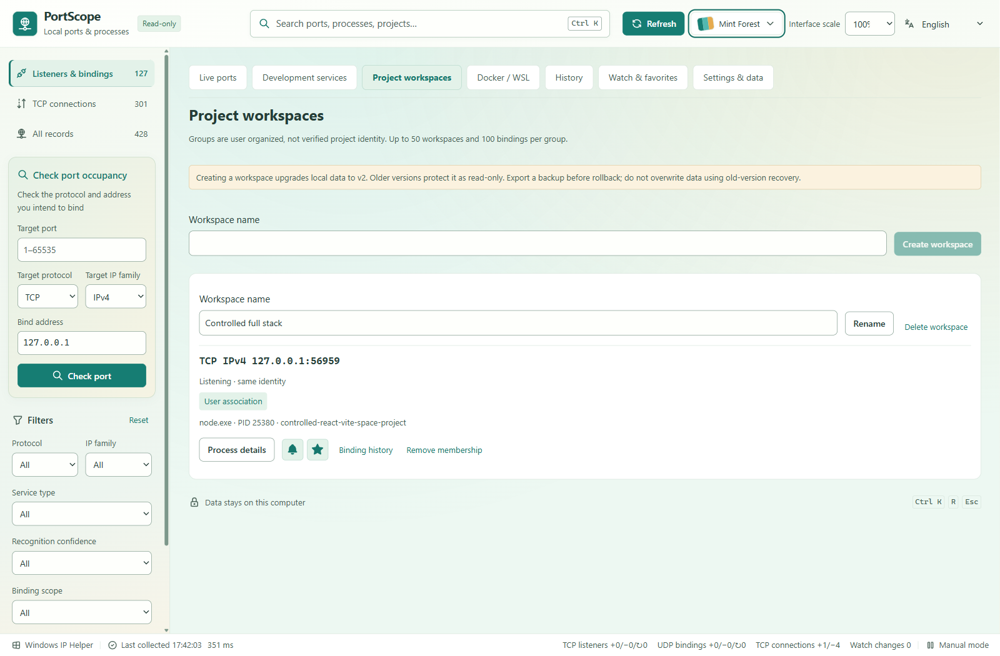

# PortScope

**See which local ports are in use, identify development projects, and follow changes over time.**

PortScope is a Windows desktop tool for developers. It observes real TCP/UDP bindings and processes, associates projects when evidence is available, and keeps local history, watches, favorites and project workspaces.

[Download 1.0.0](https://github.com/FREExuanwei/PortScope/releases/tag/v1.0.0) · [中文说明](README.zh-CN.md) · [Usage](USAGE.md) · [Privacy](PRIVACY.md) · [Known limits](KNOWN-LIMITATIONS.md) · [Third-party materials](THIRD-PARTY.md)

## Download

Windows x64 with an existing Microsoft Edge WebView2 Runtime is required. Other architectures and every Windows version/hardware combination have not been validated.

| Package | Use |
| --- | --- |
| [Windows installer](https://github.com/FREExuanwei/PortScope/releases/download/v1.0.0/PortScope_1.0.0_x64-setup.exe) | Current-user installation and normal uninstall entry; does not require administrator access. |
| [Portable ZIP](https://github.com/FREExuanwei/PortScope/releases/download/v1.0.0/PortScope_1.0.0_portable.zip) | Extract **all** files into a folder, retain `third-party`, then run `PortScope.exe`. |
| [SHA-256 checksums](https://github.com/FREExuanwei/PortScope/releases/download/v1.0.0/SHA256SUMS.txt) | Verify downloaded files before running them. |
| [Third-party notices and required sources](https://github.com/FREExuanwei/PortScope/releases/download/v1.0.0/PortScope_1.0.0_third-party.zip) | Dependency notices, exact MPL sources and source availability information. Also included in the portable ZIP and installer. |

The EXE and installer are **unsigned**. Windows may show an unknown publisher or reputation warning. Download only from this repository's Releases and compare SHA-256. A checksum confirms file integrity, not publisher identity or a security certification. If a protection policy blocks execution, keep that protection enabled and follow your organization's policy; do not disable Defender, SmartScreen, firewall or antivirus.

Portable and installed versions share the application profile. Portable means no installation, **not** that user data lives next to the EXE. Close other instances before switching versions. Back up before rollback.

## What it does

- **Real Windows observation:** TCP listeners, UDP bindings, transient TCP connections, IPv4/IPv6, binding addresses, PID and available process identity. Search, filter, query occupancy and open full details.
- **Evidence-based project recognition:** Node.js, Vite/React/Vue, Next.js, Java/Spring Boot and common Python/server clues where readable process information and directly related configuration provide evidence. Show confidence and reasons; a familiar port alone never proves a framework. Restricted information stays unavailable.
- **Independent quick actions:** the bell watches a complete binding/rule for changes; the star saves a favorite with optional user notes. Favorites do not enable alerts. Protocol, address family and binding scope matter.
- **History and lifecycle:** locally recorded listener/binding changes, sampled counts, event timelines and explicit observation gaps. First observation is not process start time; an offline interval is not reconstructed.
- **Project workspaces:** user-created groups with identity-aware binding associations. User names and notes remain distinct from verified process information. No process control or service termination.
- **Comfortable UI:** five themes, Chinese/English and 90%, 100%, 110%, 125%, 150% interface sizes. Default size is 100%.
- **Local data tools:** versioned JSON backup/restore, validation, conflict preview, cancellation, history retention and clearing. History is excluded from backup unless selected.

## Development services and workspaces

The screenshots come from real PortScope 1.0.0 running against owned local test services. They are not mockups or injected native records. The project name is a controlled fixture; path-bearing text is hidden for privacy. Screenshots may show different fixture port numbers because separate controlled runs were used.

## History

Monitoring and in-app alerts work while PortScope is running. No Windows background service or startup task is installed. History focuses on listeners and UDP bindings rather than storing every short TCP connection. Default retention is seven days; one or thirty days can be selected, and storage is bounded.

## Five themes

| Aurora Night | Vivid Day |
| --- | --- |
|  |  |
| Cyber Neon | Warm Cream |
|  |  |

## Docker / WSL: limited support

Optional, on-demand read-only metadata only: local Docker published-port mappings through the standard local engine, and a list of already-running WSL distributions. Mappings do not prove Windows PID ownership or Linux service identity. No container/distro is started, no Linux command is executed, and remote/custom Docker engines are unsupported. Real Docker container and WSL service attribution were **not** verified in the release environment. Missing components degrade to a clear unavailable state.

## Privacy and safety

Processing and application data stay on the computer. No cloud accounts, analytics, telemetry or automatic data uploads. PortScope does not kill processes, release ports, change firewall/services, elevate privileges or scan other devices. Opening a detected local URL is an explicit user action. Standard Windows/WebView components remain subject to their own platform policies.

Project inspection is limited to evidence-related files; project scripts are not executed. Full command lines and environment variables are not stored in history or default backup. User-initiated backups can contain local binding addresses, process identifiers and personal notes—review before sharing. See [Privacy](PRIVACY.md).

## Validation and limitations

The release reuses 240 frontend tests, 79 passed Rust tests (one optional project-path test not run), real native socket/project checks, isolated backup recovery, and 250 WebView layout cases. The exact 1.0.0 binary passed targeted desktop checks and a real namespaced installation/upgrade/rollback/uninstall chain; all 476 installed notice/source files were byte-verified.

About 60 minutes of baseline resource observation was recorded. The two-hour run was **not completed or passed**; its final harness assertion failed after incorrectly counting continued observations as transitions. That assertion was fixed separately without rewriting the failed run. Memory increased during the observation, so absence of a leak is not established. The owner removed the two-hour gate; see [Known limits](KNOWN-LIMITATIONS.md) and [Release report](RELEASE-REPORT.md).

Clean-VM execution of the unmodified production installer, missing-WebView2 machines, physical DPI/touchpad, real sleep/wake and network-interface changes remain unverified. This is not a claim of universal Windows compatibility or security certification.

The unchanged download archives contain a **pre-publication local acceptance snapshot**. Statements there saying “local only / no public release” describe the earlier authorization state. This repository and the v1.0.0 Release record the subsequent owner-authorized public binary distribution. The original validated binaries and archive checksums were preserved.

## Source and authorization status

This is a **binary distribution repository**, not the PortScope application source repository. It contains reviewed documentation, sanitized screenshots, dependency notices and required third-party source materials. GitHub's automatic **Source code (zip/tar.gz)** downloads contain only this repository's files, **not the full PortScope application source**.

PortScope binaries are provided for download and local use. No open-source license has been selected for PortScope's own code, and its application source is not published. Third-party components retain their respective licenses and rights; see [Third-party materials](THIRD-PARTY.md). No project-wide MIT/GPL/Apache license is implied.
