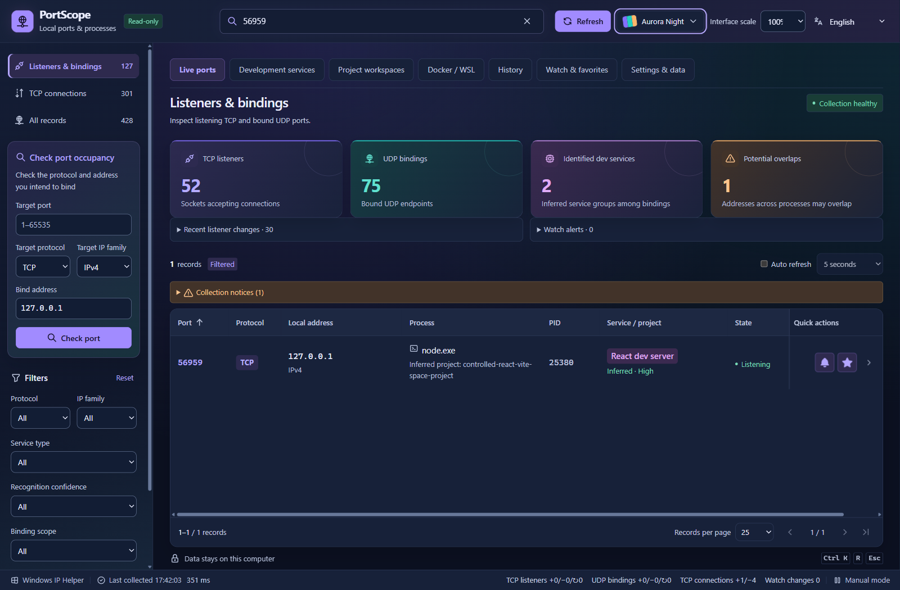
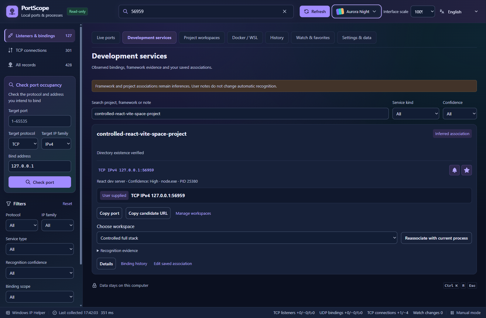
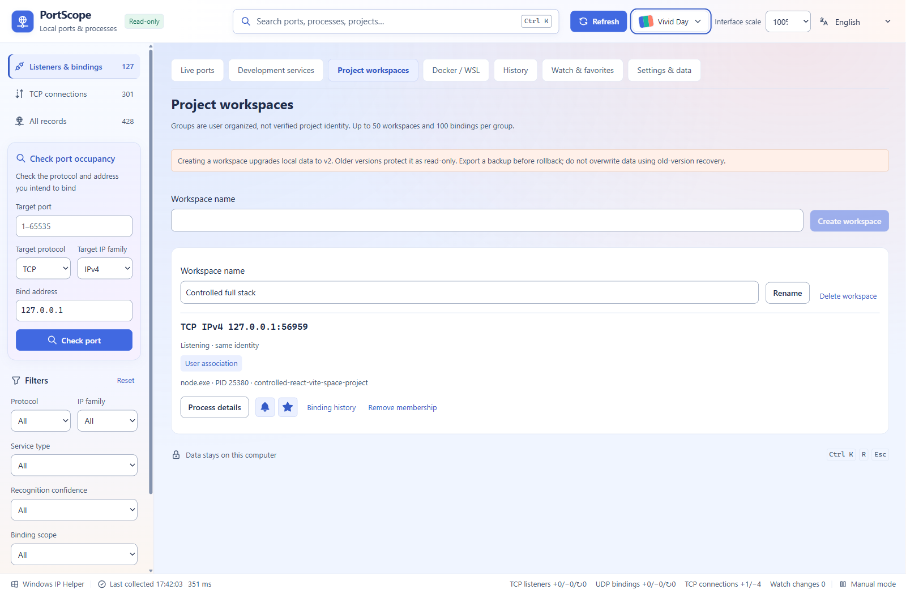
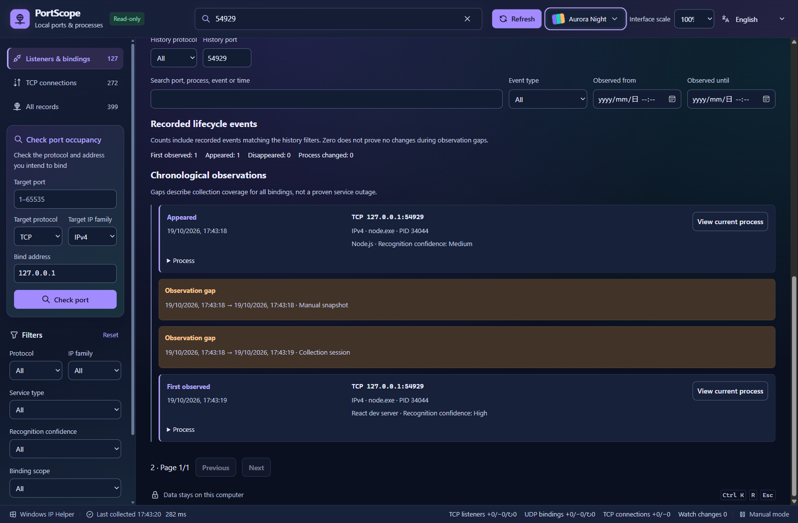

# PortScope

**查看本地端口由谁占用，识别背后的开发项目，并了解观察期间的变化。**

[English](README.md) · [下载 1.0.0](https://github.com/FREExuanwei/PortScope/releases/tag/v1.0.0) · [使用步骤](USAGE.md) · [隐私](PRIVACY.md) · [已知限制](KNOWN-LIMITATIONS.md) · [第三方材料](THIRD-PARTY.md)

## 下载与运行

支持 Windows x64，需已有 Microsoft Edge WebView2 Runtime。没有验证所有 Windows 版本、架构或硬件组合。

- [安装版](https://github.com/FREExuanwei/PortScope/releases/download/v1.0.0/PortScope_1.0.0_x64-setup.exe)：当前用户安装，提供卸载入口，无需管理员权限。
- [便携 ZIP](https://github.com/FREExuanwei/PortScope/releases/download/v1.0.0/PortScope_1.0.0_portable.zip)：完整解压，保留 `third-party` 目录，双击 `PortScope.exe`。
- [SHA-256](https://github.com/FREExuanwei/PortScope/releases/download/v1.0.0/SHA256SUMS.txt)：下载后核对文件完整性。
- [第三方通知及必要源码](https://github.com/FREExuanwei/PortScope/releases/download/v1.0.0/PortScope_1.0.0_third-party.zip)：也包含在安装包和便携 ZIP 中。

EXE 与安装包均**未签名**，Windows 可能显示未知发布者或信誉提示。请从本仓库 Releases 下载并核对 SHA-256；校验值不等于发布者身份认证。若系统或组织策略阻止运行，请保持防护开启并遵循策略，不要关闭 Defender、SmartScreen、防火墙或其他安全软件。

安装版和便携版共用应用数据身份。便携指无需安装，并不表示数据保存在 EXE 旁。切换版本前关闭其他实例，回退前导出备份。

## 主要功能

- Windows 真实 TCP 监听、UDP 绑定、短暂 TCP 连接；区分 IPv4/IPv6、地址、PID 和可用进程身份，支持搜索筛选及端口占用查询。
- 基于可读进程信息、可信启动线索和直接相关配置识别 Node.js、Vite/React/Vue、Next.js、Java/Spring Boot、Python 等。显示置信度与依据，不仅凭常见端口认定框架，不绕过权限。
- 铃铛关注和星星收藏独立：关注完整绑定或范围规则并提醒，收藏保存用户备注和标签，不自动开启提醒。
- 本地监听历史、数量趋势、生命周期和观察空档。首次观察不等于实际启动时间；未运行期间不补造事件。
- 用户项目工作区：手动分组、绑定关联和身份核对；自定义名称与已验证身份分开显示，不结束服务。
- 五主题、中英文、90/100/110/125/150% 界面大小，默认 100%。
- JSON 备份恢复、导入验证与冲突预览、取消操作、历史保留与清理。默认保留七天，可选一天或三十天，容量有上限；导出默认不包含历史。

截图来自当前 1.0.0 真实程序和受控本地测试服务，未注入原生端口记录，不是效果图。项目名称为测试夹具，路径信息已隐藏；不同受控运行的端口号可能不同。五套主题截图见 [英文首页](README.md#five-themes)。

## Docker / WSL 有限支持

仅按需只读查询标准本机 Docker 引擎的发布端口映射、已运行 WSL 发行版清单。映射不能证明 Windows PID 或 Linux 服务归属；不启动容器/发行版，不执行 Linux 命令，不支持远程/自定义 Docker 引擎。本次环境未验证真实 Docker 容器与 WSL 服务归属，组件不可用时明确降级，不声称完整支持。

## 本地数据与安全

无云账户、遥测、统计或自动上传。应用数据在本机处理和保存，不强制结束进程、不释放端口、不修改防火墙/系统服务、不提权、不扫描其他设备。打开本地候选网址需要用户主动点击；Windows/WebView 组件遵循其自身平台策略。

只读取项目关联所需的有限文件，不执行配置中的脚本。历史和默认备份不保存完整命令、环境变量或检测到的项目路径。用户主动导出的备份可能包含绑定地址、进程标识和私人备注，分享前请检查。提醒仅在应用运行时持续工作，不安装后台服务或开机任务。

## 验收范围与已知限制

复用 240 项前端、79 项 Rust 测试（1 项可选项目路径测试未运行）、真实套接字/项目识别、隔离备份恢复及 250 项 WebView 布局检查；最终 1.0.0 程序完成定向桌面检查和命名空间隔离的安装升级/回退/卸载，476 项通知与源码材料逐文件匹配。

已观察约 60 分钟，完整两小时**未完成、未通过**。收尾脚本把正常持续观察误算为变化，原失败记录保留，断言另行修复而未重跑长测。观察中内存上升，不能证明无泄漏。用户已取消两小时门槛；参见 [已知限制](KNOWN-LIMITATIONS.md) 与 [发布报告](RELEASE-REPORT.md)。

未验证干净虚拟机原生产安装包、缺少 WebView2 的机器、物理 DPI/触控板、真实睡眠唤醒及网卡变化。已通过的 WebView 仿真不是这些硬件测试。

为保持已验收文件及校验值不变，下载包内保留**公开授权之前的本地验收快照**，其中“仅本地/未公开”描述此前状态；本仓库和 v1.0.0 Release 记录后续正式授权的公开二进制分发。

## 源码及授权状态

这是二进制分发仓库，仅公开审查后的文档、截图、第三方通知及履约源码，不包含 PortScope 自有应用源码或原工程历史。GitHub 自动生成的 Source code ZIP/TAR 仅含此仓库内容，**不是完整应用源码**。

提供二进制供下载和本地使用；没有为自有代码选择 MIT、GPL、Apache 等开源许可证。第三方依赖保留各自授权和权利，详见 [第三方材料](THIRD-PARTY.md)，不能据此推定整个 PortScope 开源。
